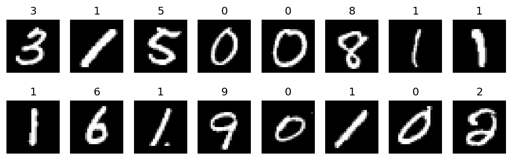
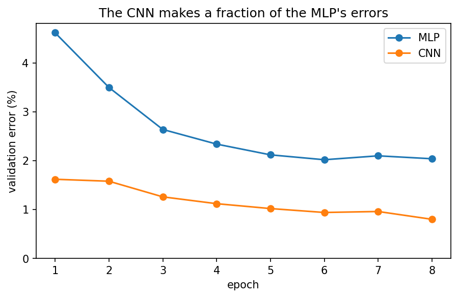
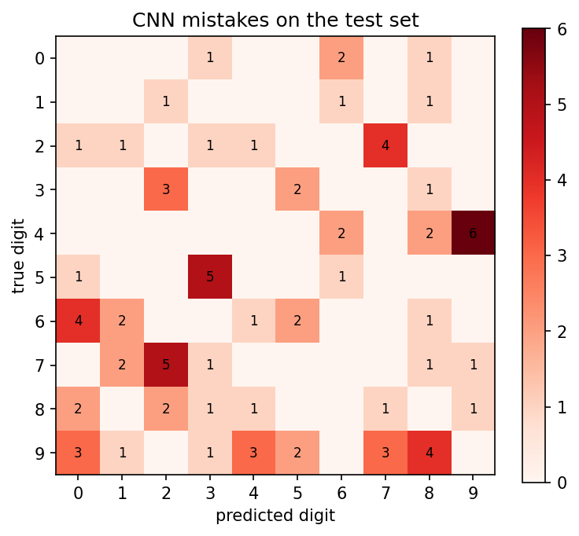
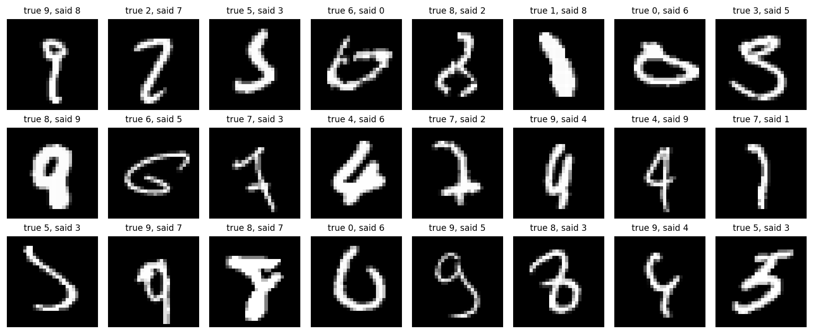
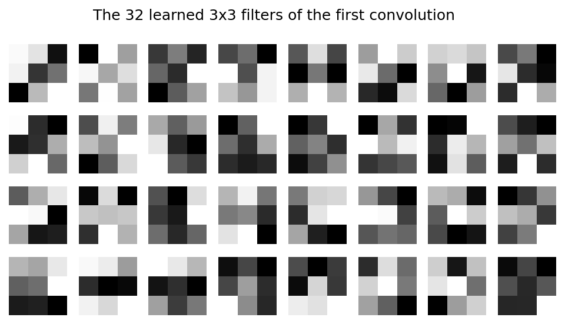
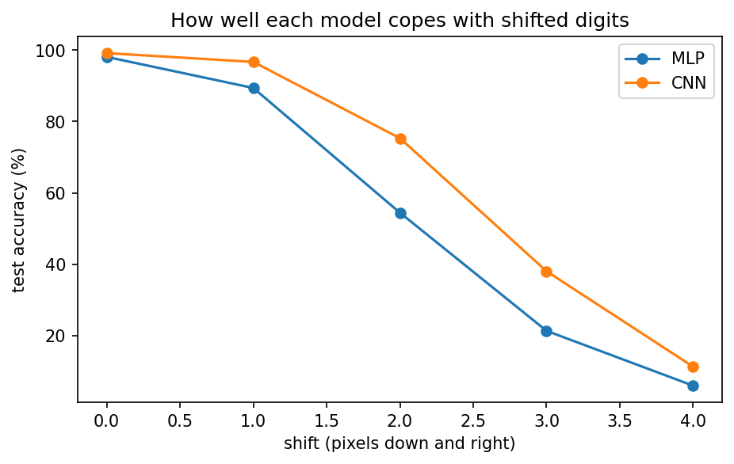

# MNIST digit recognition (MLP vs CNN)

Handwritten digit classification on MNIST in PyTorch. I trained a simple fully connected network first as a baseline, then a small CNN, and compared the two. After that I looked at the digits the CNN still gets wrong, and checked what happens when the digits are moved by a few pixels.

## Results

These numbers are on the standard 10,000-image test set, which I only ran once at the end. I picked the best epoch using a 5,000-image validation split taken out of the training data.

| Model | Params | Test accuracy | Wrong |
|---|---|---|---|
| MLP (784-256-10) | 203,530 | 98.11% | 189 |
| CNN (2 conv layers) | 1,199,882 | 99.17% | 83 |

The CNN gets 83 wrong vs 189 for the MLP, so it makes less than half the mistakes.

## Models

The MLP flattens the 28x28 image into 784 values, then goes 784 -> 256 -> 10 with a ReLU in between.

The CNN is the one from PyTorch's MNIST example:

| Layer | Output | Params |
|---|---|---|
| conv 3x3, 32 filters, ReLU | 32 x 26 x 26 | 320 |
| conv 3x3, 64 filters, ReLU | 64 x 24 x 24 | 18,496 |
| maxpool 2x2, dropout 0.25 | 64 x 12 x 12 | 0 |
| flatten | 9,216 | 0 |
| linear, ReLU, dropout 0.5 | 128 | 1,179,776 |
| linear | 10 | 1,290 |

I didn't expect this: the two conv layers together have only 18,816 params. About 98% of the 1.2M is in the first linear layer. Convs are cheap because the same small filter is reused at every position in the image.

Both models were trained the same way:

- Adam, lr 1e-3, multiplied by 0.7 after every epoch
- batch size 64, 8 epochs, on a Colab T4
- images normalised with mean 0.1307 and std 0.3081

Before the real training I ran two quick sanity checks. The starting loss should be around 2.30 (ln 10, what you get from guessing uniformly), and each model should be able to overfit a single batch of 64 images to 100%. Both passed.

## Where the CNN goes wrong

1 was the easiest digit (only 3 wrong) and 9 was the worst (17 wrong). 4, 6 and 7 had 10 each.

Most common confusions:

| True | Predicted | Count |
|---|---|---|
| 4 | 9 | 6 |
| 7 | 2 | 5 |
| 5 | 3 | 5 |
| 9 | 8 | 4 |
| 6 | 0 | 4 |
| 2 | 7 | 4 |

4/9 and 7/2 get mixed up in both directions. A 4 with a closed top looks a lot like a 9, and some of these are hard to read even for a person.

Filters learned by the first conv layer (32 of them, 3x3 each):

## Shift test

Neither model saw shifted digits during training. I moved every test image k pixels down and k pixels right and ran the test again:

| Shift (px) | 0 | 1 | 2 | 3 | 4 |
|---|---|---|---|---|---|
| MLP | 98.1% | 89.4% | 54.4% | 21.3% | 6.0% |
| CNN | 99.2% | 96.7% | 75.3% | 38.0% | 11.3% |

The CNN handles a 1-pixel shift much better (96.7% vs 89.4%). By 3-4 pixels, though, both are basically broken, and 10% is random guessing. The conv layers don't care where a pattern appears, but the linear layer after them does, because each of its weights is tied to a fixed position. So a CNN isn't automatically shift-invariant. Training on randomly shifted images (augmentation) should fix most of this, but I haven't tried it yet.

## Takeaways

The MLP baseline is what gives the CNN's number its meaning. 99.17% on its own doesn't say much, but going from 189 mistakes to 83 does. The shift test was the most interesting part for me. "CNNs are translation invariant" turned out to be only partly true, and the parameter count shows why.

## Next

- train with random shifts/rotations and redo the shift test
- swap the big linear layer for global average pooling (far fewer params)
- try Fashion-MNIST or CIFAR-10, where the gap between models should be bigger

## Running it

Open the notebook in Colab, set the runtime to a T4 GPU, and click Run all. It downloads MNIST on its own and takes about 5 minutes.

## Credits

The CNN architecture is from PyTorch's [MNIST example](https://github.com/pytorch/examples/tree/main/mnist). The MNIST dataset is from LeCun et al., 1998, [Gradient-based learning applied to document recognition](http://yann.lecun.com/exdb/publis/pdf/lecun-01a.pdf).
